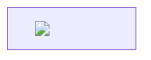

# Task 7: Untrusted Content Rendering

Date: 2026-10-28

Status: Review complete. Three findings; six intentionally failing component regressions and two passing controls retained. No application fixes implemented. Final verification limitations are recorded below.

## Scope And Evidence

Reviewed model-controlled Markdown, code fences, SVG, Mermaid, math, links, images, preprocessing, asynchronous publication, and diagram cleanup in `MarkdownWithCode.tsx`. Read the existing rendering/preprocessing/math tests and installed ReactMarkdown, rehype-katex, Mermaid, and DOMPurify implementations.

Component tests execute the actual component and DOMPurify sanitizer. Their existing Markdown double routes fenced blocks to the real component renderers; Mermaid itself is mocked. These tests establish final DOM contents and component cleanup, not real Mermaid parsing or browser networking.

Separate bounded probes exercised the installed real Markdown/math pipeline and a local browser page with installed DOMPurify/Mermaid. Browser network requests to the reserved `render-review.invalid` host were intercepted and aborted; no external host received them. The browser probes were not a full Athena application integration run. The temporary read-only probe server was stopped afterward.

No executable JavaScript injection was confirmed. The findings distinguish page-wide CSS effects, unsolicited network requests, and orphaned rendering DOM.

## Findings

### REN-01: Sanitized SVG can apply CSS to the entire application document

Priority: High. Category: UI integrity and availability, not confirmed JavaScript execution.

Locations: [style tags admitted](../../src/components/MarkdownWithCode.tsx#L212), [sanitizer](../../src/components/MarkdownWithCode.tsx#L328), [direct SVG DOM insertion](../../src/components/MarkdownWithCode.tsx#L395).

Minimal payload:

````markdown
```svg
<svg><style>body { display: none; }</style></svg>
```
````

Trigger: Open a message containing that SVG fence. The sanitizer preserves its `style` element and rule. `dangerouslySetInnerHTML` inserts it into the application's document, without a separate document or style boundary. SVG stylesheet selectors are not automatically scoped to that SVG.

Impact: Model-controlled content can hide the entire application, including controls outside the message. Similar document-wide selectors can change unrelated UI appearance. DOMPurify stripping scripts and event handlers does not imply CSS confinement. Removing only scripts does not repair this trust boundary; inline styles and HTML integration also require an explicit policy.

Evidence: The actual component/sanitizer regression finds `body { display: none; }` in its inserted SVG stylesheet. A separate browser probe sanitized and inserted that minimal SVG, then observed `getComputedStyle(document.body).display === 'none'`. It removed the probe afterward. This demonstrates page-wide style impact, not access to JavaScript, stored keys, or arbitrary DOM reads.

Suggested fix: Render untrusted diagrams in a genuinely isolated document with an appropriate sandbox/resource policy, or apply a restrictive CSS policy that prevents document-wide selectors and out-of-bounds presentation. Preserve legitimate Mermaid styling deliberately rather than assuming ordinary HTML sanitization scopes it. Apply the same boundary to all paths sharing this sanitizer.

Regression: [REN-01](../../src/components/MarkdownWithCode.test.tsx#L411). The rule must not reach the application's shared stylesheet scope.

### REN-02: Rendering untrusted content initiates unapproved external-resource requests

Priority: Medium. Category: Privacy/network boundary.

Locations: [SVG allowlist](../../src/components/MarkdownWithCode.tsx#L212), [HTML integration points](../../src/components/MarkdownWithCode.tsx#L325), [Mermaid loose mode and render](../../src/components/MarkdownWithCode.tsx#L146), [post-render sanitization](../../src/components/MarkdownWithCode.tsx#L151), [default Markdown image rendering](../../src/components/MarkdownWithCode.tsx#L700).

Minimal payloads:

````markdown


```svg
<svg><image href="https://render-review.invalid/pixel.svg"/></svg>
```

```svg
<svg><foreignObject></foreignObject></svg>
```

```svg
<svg><style>@import url("https://render-review.invalid/style.css");</style></svg>
```


````

Trigger: Display model output containing one of these resource references. The SVG sanitizer permits HTTP(S) resource URLs, image elements, HTML labels, and stylesheet text. ReactMarkdown's default URL transform rejects dangerous schemes but permits ordinary HTTPS images; Athena installs no image approval/proxy renderer. There is no approval interaction before these sinks are created.

Mermaid has an additional pre-sanitization sink: Athena calls `render(id, definition)` without a containing element. The library constructs temporary elements in `document.body` while rendering HTML labels. A resource can be requested there before Athena receives and sanitizes the returned SVG. Sanitizing only the final string cannot undo that request.

Impact: Merely opening a message can disclose client network metadata and a model-selected tracking identifier to an external server. Remote CSS can introduce additional resource references. This is not proof that arbitrary localStorage values or API keys were read; sensitive information would have to be present in the selected URL or obtained through some separately demonstrated channel. This finding assumes untrusted generated output should not silently contact arbitrary third parties without a deliberate resource policy.

Evidence: Real component/DOMPurify regressions preserve URLs in SVG images, HTML images in `foreignObject`, CSS imports, and mocked Mermaid output. A completed real Markdown-pipeline probe produced an HTTPS `img` from the first payload. In the browser, real Mermaid rendered an HTML image label and an intercepted GET to `/mermaid.png` occurred even though the returned SVG was never inserted by the probe. An included `onerror` marker was removed and did not execute; the confirmed issue is the request, not that event handler.

Suggested fix: Define a consent, proxy, or allowlist policy for generated external resources across Markdown, SVG, HTML labels, and CSS. Prevent network-capable input from reaching Mermaid's temporary DOM; blocking only the final inserted SVG is insufficient. Prefer an isolated renderer with an enforced network policy. Keep ordinary user-activated hyperlinks distinct from automatic resource loading.

Regressions: [Mermaid output](../../src/components/MarkdownWithCode.test.tsx#L186), [three SVG resource forms](../../src/components/MarkdownWithCode.test.tsx#L419). The tests identify the content SVG, not an unrelated MUI icon, and permit a fix to remove resource elements while preserving the SVG root. The real Markdown and pre-return Mermaid observations are separate probes, not permanent end-to-end tests.

### REN-03: Failed Mermaid renders leave global DOM outside React's cleanup ownership

Priority: Medium. Category: Availability and lifecycle isolation.

Locations: [render without an owned container](../../src/components/MarkdownWithCode.tsx#L149), [catch only publishes an error](../../src/components/MarkdownWithCode.tsx#L153), [effect cleanup](../../src/components/MarkdownWithCode.tsx#L165).

Minimal payload:

````markdown
```mermaid
flowchart TD
 A[
```
````

Trigger:

1. A persisted invalid definition, or an incomplete streamed definition after the debounce, reaches `mermaid.render`.
2. The library creates a body-level `d<render-id>` container and draws an error SVG. In the installed version, its parse-exception path throws before the normal temporary-element removal.
3. Athena catches the error and displays its React error view. It neither owns the library's body-level container nor removes it on failure/unmount.
4. Replacing the source or leaving the view removes the React component but leaves the separate error SVG. New random render IDs do not reuse that old container.

Impact: Invalid model output leaves extra content outside the message and accumulates DOM across failed renders. The library error diagram and React error view can both appear. The cancellation flag protects final component publication but does not clean up external renderer side effects. This is not a claim that the orphaned error SVG executes model JavaScript.

Evidence: A browser probe invoked installed Mermaid with the minimal invalid definition. It rejected while `dreview-invalid` and its error SVG remained direct children of `document.body`; the probe explicitly removed them afterward. The component regression models that demonstrated renderer behavior, waits for Athena's error, unmounts, and fails because the temporary element remains. Its `finally` removes the test artifact to avoid contaminating later cases.

Suggested fix: Give rendering a dedicated owned container and clean it up in a `finally`/effect cleanup path, including cancellation and rejection. Consider Mermaid's error-rendering suppression option, but do not rely on successful-render cleanup for failures. Preserve stale-result ownership checks when changing the render lifecycle.

Regression: [REN-03](../../src/components/MarkdownWithCode.test.tsx#L226). After rejection and unmount, no renderer-owned temporary DOM should remain in the page.

## Protected Boundaries And Unverified Risks

- Existing component tests verify that final SVG/Mermaid output loses script elements and event handlers. A new retained control verifies that JavaScript SVG links and SMIL `href` retargeting are removed by the installed sanitizer.
- A retained asynchronous control resolves an old Mermaid render after a replacement source has rendered. The stale SVG is not published. Source keys and cancellation checks protect this final-publication path; REN-03 concerns side effects outside that path.
- Completed real-pipeline probes found raw HTML inert, JavaScript Markdown links/images blocked by the default URL transform, and trusted KaTeX links/images disabled. The application does not enable KaTeX trust. Those observations do not constitute an exhaustive XSS proof, and the subprocess probes were removed from the permanent Jest suite because test invocations became unacceptably slow.
- Mermaid applies its configured/default maximum text size inside the library, after application preprocessing. Preprocessing's repeated suffix search for an SVG closing fence can do repeated work on many closing-tag lines. No application-wide budget for preprocessing, SVG DOM size, CSS/filter complexity, or number of diagram fences was verified. These remain unquantified availability risks, not additional confirmed denial-of-service findings.
- A recursive-math stress control was attempted but never completed verification and was removed. No claim is made that this particular payload exhausts the application or that its expansion limit was experimentally verified here.
- Browser probes tested installed libraries on a local page, not the fully deployed application's headers or a provider-backed conversation. The CSS effect and Mermaid temporary-DOM/network behavior were observed directly; other surviving resource forms were established at their final DOM sinks, not individually network-traced in a browser.

## Tests And Verification

Retained eight additions in the existing [component suite](../../src/components/MarkdownWithCode.test.tsx): six desired-behavior regressions covering the three findings, and two passing controls. New names start with `REN-`. No subprocess is launched by the final test file.

Optional focused command for the subsequent fix pass:

```bash
npm test -- --watchAll=false --runInBand --testPathPattern="MarkdownWithCode.test" --testNamePattern="REN-"
```

Each retained case was exercised in completed earlier focused runs. The last completed combined review run, before removing four subprocess-based parser cases, reported **7 failed, 5 passed, 30 skipped**; failures were the intended CSS/resource/cleanup assertions. The retained set removes one remote-Markdown-image failure and three real-parser controls from that run, leaving six previously observed failures and two previously observed passing controls.

Repeated later terminal invocations were interrupted/cancelled and the user requested faster tests. The recursive-math probe and all subprocess parser probes were removed. The final slimmed suite and the complete rendering suites were **not rerun**, so no fresh final suite total is claimed. Editor diagnostics report no errors in the modified test file. Final touched-file ESLint completed with no reported errors after exceeding the initial 15-second foreground limit. No application source or interface changed; no production build or unrelated full suite was run.